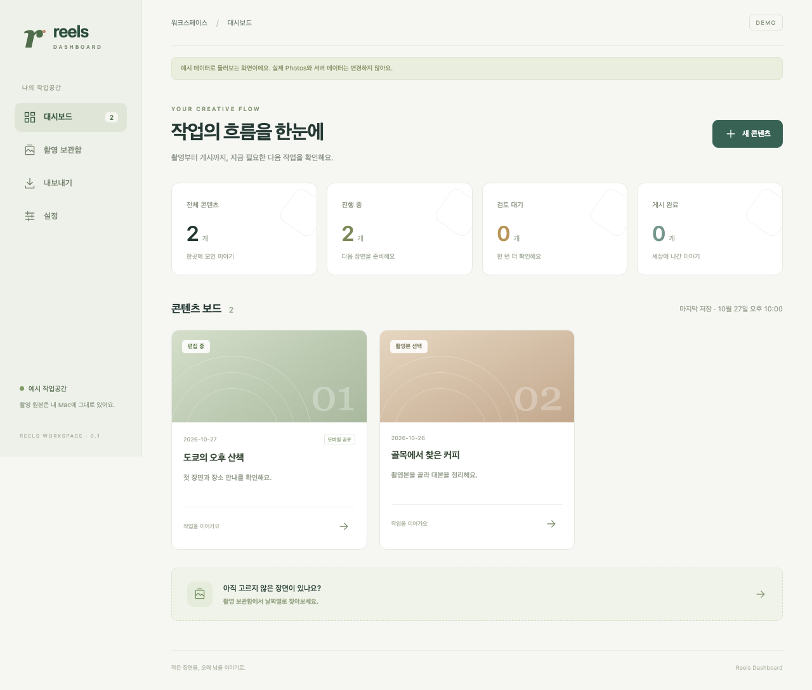

# Reels Dashboard

## Workspace routing

Content production and operations stay in the Obsidian reels workspace, with **active use of Reels Dashboard throughout the production workflow**. Check the app's current capabilities and use them for discovery, selection, editing, export and progress tracking. When real production work reveals a missing capability or a usability problem, develop and validate the needed feature in this repository, then apply it to that production work. The intended loop is **content work → app use → needed feature development and validation → application to content work**. Separate folders define source and record ownership; they do not separate app use from content production. Do not treat unimplemented or unverified features as ready to use.

The development checkout belongs at `~/side/reels-dashboard`, in a dedicated **Reels Dashboard** local project. `work` denotes KakaoWork-related work; this side project belongs under `side`.

- App features, bugs, Electron/React/Swift code, the bundled editor, tests, packaging and shared-web development: this repository. Start with [AGENTS.md](AGENTS.md) and [TASKS.md](TASKS.md).
- Reel concepts, scripts, captions, account strategy and production history: [the Obsidian reels workspace](~/Obsidian/side/reels/README.md), following its [AGENTS.md](~/Obsidian/side/reels/AGENTS.md).
- Original media and completed exports: their existing Photos/iCloud locations. Keep personal media and production data out of this public source repository.

The existing Obsidian editing CLI and the bundled app engine have separate source ownership. Consult [the engine documentation](docs/editor-engine.md) for app changes; do not silently update both implementations. Cross-workspace links are local navigation aids, not runtime dependencies.

Transition status (2026-10-27): the entire checkout was moved to the new path, preserving Git history, uncommitted changes and source files. The previous path contains redirect documentation only. This move does not establish build or runtime validation at the new path.

A local-first reel production app for finding footage in Apple Photos and local folders, editing video captions and covers, exporting finished media, and tracking work through publication. Built with **Electron + React**; the same dashboard also supports a shared web build for ChatGPT Sites.



Latest integrated implementation and validation: [2026-10-31 release record](docs/integration-release.md).

## Features

- Production projects group saved video/card-news edits, linked resources and output versions on one card. Merge existing cards with a pre-merge backup; future exports follow the owning project. See [project model and schema](docs/production-projects.md).

- Photo/video-based card-news Reels: adjustable reading-time recommendations, card order and music controls, matching previews, saved drafts and vertical MP4 export. See [card-news workflow and evidence](docs/card-news.md).
- Bundled Swift helper: PhotoKit authorization, date indexing, GPS-radius/OCR search through MCP, coarse/fine capture groups, paged previews and privacy flags.
- Complete include/exclude decisions with native validation; reviewed, digest-bound copy and move plans.
- Verified iCloud move and interrupted-move recovery, retaining PhotosIndex's integrity checks and recovery journals.
- Local production dashboard with persistent stages, next actions and public links; media thumbnails, a video/image/audio viewer and paginated browsing of linked footage folders.
- An integrated video editor: select a Photos or local video, edit timed captions and a place-guide bundle, choose a cover frame and two-line hook, then export video/audio and a PNG cover.
- A bundled Python/Pillow/FFmpeg runtime, exact engine previews, browser playback proxies, saved drafts, progress and cancellation.
- Five existing video/cover template cards beside playback, independent grouped position offsets and explicit cover sizing; content and timing are preserved.
- Reviewed UTF-8 SRT/plain WebVTT caption import and SRT export, using an attributed MIT parser adaptation from OpenCut Classic; see [adoption notes](docs/opencut-adoption.md).
- Explicitly selected shared snapshots, a common web renderer and an HTTPS update-endpoint adapter.
- Isolated Electron renderer, narrow preload API, granted-file access and helper lifecycle management.
- Dedicated Dock icon and a macOS menu-bar icon with dashboard, app information and quit actions. See [app identity and icon generation](docs/application-identity.md).

All **26 upstream test files / 75 tests** are preserved byte-for-byte. The native component does not depend on a separately installed PhotosIndex app. Apple Photos functionality remains macOS-specific.

## Compact workspace

The window uses a compact toolbar: back/forward, screen history and menu/content search on the left; settings and the opt-in terminal on the right. The large introductory titles and sidebar development/settings entries are removed. See [window layout and terminal controls](docs/workspace-shell.md).

## Agent integration

The desktop **터미널** is enabled explicitly with `REELS_DEV_MODE=1 npm start` after building. It connects this source checkout to Codex and shell PTY sessions, a local web preview, verification commands and the existing briefing site. It is absent from normal desktop startup and the shared web app. Codex is the default; the provider boundary reserves Claude Code for a later release. Design → implement → review → fix prompts support a user-directed improvement loop. See [architecture, usage and validation](docs/development-workspace.md).

Owner-private [mobile production briefing](https://example.chatgpt.site) stores progress metadata in Sites D1. See [mobile briefing operation and current scope](docs/mobile-briefing.md).

Existing footage folders, completed videos/covers and content documents can be linked locally through MCP without proxy generation or media copies. See [local content library](docs/local-content-library.md).

The desktop editor exposes a local stdio MCP server for project lookup, partial editing, previews, rendering and Photos discovery. It uses a private Unix socket and shares the UI's editor service. See [MCP setup and tools](docs/mcp-usage.md) and [interface design](docs/agent-interface.md).

## Run locally

The bundled editor build currently targets Apple Silicon and macOS 15+. Source builds require Swift 6, Node 22.12+ and the [editor build dependencies](docs/editor-engine.md); the packaged app includes its Python/Pillow/media runtime.

```sh
npm ci
npm run build:native
npm run build:editor
npm run build
npm start
```

Local builds use **Developer ID Application** signing for the PhotosIndex helper, with the existing `dev.pray.PhotosIndex` identifier. The signer discovers one unique valid identity or uses `PHOTOSINDEX_SIGNING_IDENTITY` to select one by its complete name. Missing or ambiguous identities fail the build; there is no local ad-hoc fallback. See [stable Photos permissions and signing](docs/native-signing.md).

Browser development: `npm run dev`; open `http://127.0.0.1:4173/?demo=1` for explicitly synthetic data. The normal web mode reads `public/snapshot.json` and has no local Photos capabilities. See [Sites integration](docs/sites-integration.md).

Create a local macOS app bundle:

```sh
npm run package:mac
```

Output: `release/mac-arm64/Reels Dashboard.app` on Apple Silicon. The outer Electron package remains unsigned; its PhotosIndex helper uses Developer ID signing. This is a local build, not a notarized public distribution.

## Verification

```sh
npm run verify:spec
npm run typecheck
npm test
npm run test:native
npm run test:native-rebuild
npm run test:native-install
npm run build
npx playwright install chromium
npm run test:web
npm run test:electron
REELS_NATIVE_QA=1 npm run test:electron -- tests/electron/native.spec.ts
npm run audit:public
```

Editor-phase results: **95 Swift tests, 13 TypeScript tests, 58 Chromium UI tests, 11 standalone editor-engine tests, 8 packaged desktop/editor checks, and 1 live Photos-to-editor check passed**. See [the editor workflow](docs/editor-workflow.md), [editor web QA](docs/editor-web-qa.md) and [editor Electron QA](docs/editor-electron-qa.md). The prior PhotosIndex milestone records remain below for provenance. See [verification](docs/verification.md), [web QA](docs/web-qa.md), and [Electron QA](docs/electron-qa.md) for coverage and limits. After explicit user consent, live Photos metadata, a bounded one-asset PhotoKit/Vision preview and JPEG decoding passed through the packaged Electron bridge. No personal photos were moved or deleted by automated QA.

## Specification and migration

- [Complete original test specification](docs/photosindex-test-spec.md) and [machine-readable inventory](docs/photosindex-test-inventory.json)
- [UI and command specification](docs/photosindex-ui-spec.md)
- [Architecture and data boundaries](docs/architecture.md)
- [Reusable delegated migration workflow](docs/migration-workflow.md)
- [Native migration](docs/native-migration.md)
- [Acceptance matrix](docs/acceptance-matrix.md) and [release audit](docs/release-audit.md)
- [Progress and remaining work](TASKS.md)

The app now combines the PhotosIndex workflow, a single-source video editor and the reusable dashboard. Multi-clip timeline assembly and deployment of a live Sites receiver are separate future work. Public source contains no personal media, production snapshots, credentials, or runtime databases.

## License

MIT. The migrated PhotosIndex native code retains its original license and copyright notice, also included in the app package.


Signed follow cards are available as video editor preset **6 — 서명 있는 팔로우 마지막 장**: editable message, CTA, account signature and darkness, with standalone 1080×1920 PNG export. See [editor workflow](docs/editor-workflow.md).
