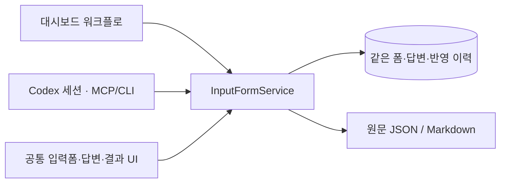

# 공통 입력폼과 답변 서비스

대시보드 실행 모드는 제작 단계를 계속 관리한다. Codex 세션 모드는 대화에서 작업을 진행하면서 필요한 폼만 보낸다. 두 모드가 **같은 formId, 같은 저장소, 같은 React 입력/답변/결과 화면**을 사용한다. 세션 모드에서 폼을 생성해도 워크플로 실행이나 모델 작업은 생성되지 않는다.



## 데이터와 소유권

- `shared/experience.ts`: 질문/사실/이미지와 답변 상태 계약. `answered`, `unknown`, `omit`을 구분한다.
- `shared/input-forms.ts`: 공통 폼 리소스, 생성/저장/결과/반영/대기 계약. `formResultsSchema`가 구조화 출력 정본이다.
- `app/workflow/input-form-service.ts`: 폼 저장, revision 검사, 사진/근거 검사, 원문 내보내기, 변경 대기, 반영 이력. LangGraph 단계에 의존하지 않는다.
- `app/workflow/runtime.ts`: 대시보드 어댑터. 준비 단계가 공통 폼을 등록하고 제출 결과를 `requests` 단계에 연결한다. 초안/수정 완료 결과는 같은 폼의 applications에 기록한다.
- `features/workflow/ui/ExperienceForm.tsx`: 두 모드의 공통 입력/제출본/반영결과 컴포넌트. `WorkflowPanel`과 `FormInbox`가 동일 컴포넌트를 사용한다.
- `desktop/input-form-window.ts`: MCP/CLI 요청으로 같은 화면을 별도 앱 창에 연다. 동일 폼 창을 중복 생성하지 않는다.

폼에는 `schemaVersion`, `formId`, `workspace`, `projectId`, `revision`, `status`, `form`, `answers`, `sourceHashes`, `exports`, `submissionRevision`, `applications`가 있다. 대시보드에 연결하면 `workflowRunId`가 추가된다. 답변 원문과 반영 결과는 서로 덮어쓰지 않는다. application은 특정 결과 파일에 반영했다는 기록이며 워크플로 검토 통과·발행 완료를 뜻하지 않는다.

새 `formId`를 지정해 create를 재시도하면 동일 입력은 같은 리소스를 반환하며 다른 내용은 거부한다. 제출 후 질문을 바꿀 때는 새 폼으로 요청한다. API는 사용자의 답변을 생성하지 않는다.

## MCP와 CLI

같은 서버를 사용한다. 데스크톱 앱은 서버를 내장하며([내장 서버](workflows.md#desktop-embedded-server--2026-11-03)), 앱 없이 쓸 때 서버 실행은 `npm run start:server`, stdio MCP는 `npm run start:workflow-mcp`, CLI는 `npm run forms -- …`다. 다른 포트는 `REELS_WORKFLOW_URL=http://127.0.0.1:<port>`로 지정한다. 서버를 새로 만들거나 DB 파일을 직접 수정해서 연결하지 않는다.

| MCP | CLI | 역할 |
| --- | --- | --- |
| `reels_forms_list` | `forms list [projectId]` | 공통 폼 목록 |
| `reels_form_create` | `forms create <json-file\|->` | 워크플로 없는 폼 생성 |
| `reels_form_get` | `forms get <formId>` | 질문·답변·revision·연결 읽기 |
| `reels_form_open` | `forms open <formId> [--desktop]` | URL 반환 또는 앱 창 열기 |
| `reels_form_save` | `forms save <json-file\|->` | 실제 사용자 입력 임시저장/제출 |
| `reels_form_wait` | `forms wait <formId> <afterRevision> [timeoutMs]` | 최대60초 변경 대기 |
| `reels_form_results` | `forms results <formId>` | 질문 순서의 구조화 답변·출처·출력 |
| `reels_form_media` | `forms media <json-file\|->` | 등록된 질문 이미지 읽기 |
| `reels_form_apply` | `forms apply <json-file\|->` | 결과 파일과 반영 내역 기록 |
| `reels_form_artifact` | `forms artifact <json-file\|->` | 등록된 텍스트 결과 읽기 |
| `reels_form_sync` | `forms sync <formId>` | 중단된 제출→워크플로 전달 재연결 |

CLI 표의 `forms`는 `npm run --silent forms --`를 줄여 쓴 것이다. 프로그램에서 JSON을 읽을 때는 npm의 배너가 섞이지 않도록 `--silent`를 쓰거나 `node --import tsx src/app/workflow/forms-cli.ts …`를 직접 호출한다. JSON 입력은 파일 또는 stdin이며 셸 인용으로 본문을 조립할 필요가 없다. 네이티브 Dashboard MCP에도 같은 `reels_form_*`/`reels_forms_list` 도구를 같은 레지스트리에서 노출하고 공통 서버로 전달한다. 기존 Dashboard MCP 연결은 새 빌드/도구 재연결 후 재사용할 수 있으며, 별도 서버 설정이 필수는 아니다. `reels_open_input_form {formId}`는 실제 앱 창을 여는 네이티브 도구다. 공통 서버의 `form-open`에서 `surface:"desktop"`을 지정하면 이 도구로 연결한다. 앱이 꺼져 있거나 이전 빌드여서 도구가 없으면 오류를 반환한다. 기본 `surface:"link"`는 창을 띄우지 않고 URL만 반환한다.

### 세션에서 생성하고 답변 받기

```json
{
  "workspace": "/absolute/path/to/content",
  "projectId": "content:example",
  "sourceFiles": ["facts.md"],
  "form": {
    "version": 1,
    "title": "사진을 보며 기억 채우기",
    "introduction": "기억나는 표현을 그대로 적어주세요.",
    "facts": [],
    "questions": [{"id":"memory","section":"기억","prompt":"무엇이 기억나나요?","images":[]}]
  }
}
```

`create → open → wait/get → results → 작업 수행 → apply` 순서로 사용한다. wait는 `{formId,afterRevision,timeoutMs}`를 받아 `{reason:"change"|"timeout"|"closed",form}`을 반환한다. 부분 저장도 revision 변경이므로 `form.status === "submitted"`를 확인한 뒤 답변을 반영한다. Codex 세션이 종료돼도 폼/답변은 저장된다. 제출이 종료된 세션을 자동으로 다시 실행하지는 않는다.

저장 입력은 `{formId,expectedRevision,answers:[{questionId,status,text}],submit}`다. `results`는 version 1 구조로 `responses:[{questionId,section,prompt,status,text,images}]`, `sourceFacts`, `sourceHashes`, `exports`, `applications`를 반환한다. 빈칸을 감상으로 보충하거나 `unknown/omit`을 삭제하지 않는다.

반영 입력은 `{formId,expectedRevision,summary,evidence:["draft.md","review.md"]}`다. 실제 파일과 해시를 확인하고 application에 기록한다. `form-artifact`는 exports 또는 application의 등록된 `.md/.txt/.json`만 최대2MB로 읽으며 다른 경로·변경된 결과를 거부한다.

### 대시보드로 이어가기

워크플로 create에 `inputFormId`를 넣고 동일 workspace를 지정하면 같은 폼을 연결한다. 미제출이면 경험 단계, 이미 제출됐으면 답변 요청 분류에서 시작한다. 기존 답변이나 원문 내보내기 파일을 복제하지 않는다. 하나의 폼을 여러 실행에 동시에 바인딩하는 요청은 거부한다.

대시보드의 기존 준비→경험 흐름도 공통 서비스를 호출한다. 기존 `experience-save/media` API는 같은 서비스의 대시보드 어댑터이며 별도 저장 경로가 아니다. 답변이 제출된 뒤 연결 전달에 문제가 생기면 저장본은 남고 `form-sync`로 이어간다. 같은 제출을 다시 동기화해도 단계를 두 번 진행하지 않는다.

## 기존 자료 보존과 경계

기존 `experience_records` 행과 export 경로를 재사용한다. 첫 조회/서버 시작 시 기존 워크플로 레코드에 공통 메타데이터를 덧붙인다. 기존 formId는 runId와 같으며 사용자 원문·revision·출처 해시·export 파일 내용은 바꾸지 않는다. 실행 이력과 워크플로 상태도 유지한다.

폼 변경은 단일 서버의 직렬 쓰기를 거친다. 두 모드의 저장은 같은 expectedRevision 검사를 사용한다. 입력 중 두 보기의 전환과 공통 폼 목록의 선택은 저장 후 가능하며 다른 창의 저장이 현재 입력을 덮어쓰지 않는다. SDK 실행 중인 워크플로에 연결된 폼 쓰기는 기존 실행 잠금을 따른다. 이미지/결과는 등록된 작업폴더 안의 파일만 읽고 외부 symlink·경로 이탈을 거부한다. 서버는 기존 loopback Host/Origin 경계를 유지한다. 공개 공유·업로드·게시 기능은 추가하지 않는다.

## 검증 및 적용 — 2026-11-02

- 공통 폼/워크플로 관련 단위16개 통과. 실제 stdio MCP와 CLI를 통해 생성·부분 저장·제출·변경 대기·결과·반영·창 열기·조회가 같은 레코드를 사용하는지 확인했다. source/answer 보존, 동일 ID 생성 재시도, stale revision, 중복 바인딩, 결과 파일 변경, 경로 경계를 검사했다.
- 웹5개 통과: 기존 대시보드 실행 흐름, 공통 사진 질문, 추가 요청 작업, CLI에서 보낸 폼의 UI 작성과 두 창 충돌, 제출 원문/결과 화면,390px 넘침 확인.
- 최종 패키지 Electron2개 통과: 공통 대시보드 폼의 제출과 네이티브 MCP→공통 서버→별도 앱 폼 창 열기·중복 창 방지·답변 반환. 격리 프로필/합성 자료/기본 background QA 사용.
- 타입/FSD/빌드/diff 검사 통과. 전체 단위159개는 직렬 실행에서 통과했다. 첫 병렬 실행의 기존 실행로그 타이밍 검사1개가 실패했으며 해당 검사 단독5개와 전체 직렬159개는 통과했다. 이 작업에서 실행로그 코드는 수정하지 않았다.
- `release/shared-input-forms/mac-arm64/Reels Dashboard.app`를 검증한 뒤 기존 실행본을 백업하고 `release/production-projects/mac-arm64/Reels Dashboard.app`에 적용했다. 설치 app.asar와 검증 패키지의 SHA-256이 일치한다.
- 기존 운영 데이터에서는 단계·task ID·history·답변·revision·export 해시 보존을 확인한 뒤 새 반영 이력을 추가했다. 실제 CLI와 네이티브 MCP의 구조화 결과가 동일하며 앱 창에서 제출 원문/등록 결과를 읽는 것까지 확인했다. 개인 콘텐츠 검증 자료는 콘텐츠 작업공간에만 보관했다.
