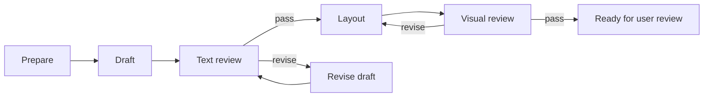

# Headless editorial workflows

LangGraph owns stage transitions and durable checkpoints. Work can be performed by the **current Codex session**, or by explicitly starting one **Codex TypeScript SDK** job. Both use the same task/result validation. Saved Codex login works without an API key. Electron and shell orchestration loops are not required.

## Start

Use Node 22.12+ and the repository dependencies (`npm ci`).

```sh
npm run build:web
npm run start:server
```

Open `http://127.0.0.1:4318/?workflow=1`. The existing Dashboard shell includes a Workflow tab. Workflow create/list/task/result/restart operations work without Electron. Other existing native features (Photos, native editor and hidden Electron reference extraction) retain their current platform requirements; this change does not pretend to port those tools to a browser.

`REELS_WORKFLOW_DATA` selects the private storage directory (default `~/.local/share/reels-dashboard/workflows`). SQLite checkpoints and run IDs live outside the source repository. `REELS_WORKFLOW_PORT` sets the server port; clients use `REELS_WORKFLOW_URL`. One server owns a storage directory. CLI and MCP always call that server, rather than independently executing the same graph. The HTTP service binds only to `127.0.0.1` and rejects other Host/Origin values.

## Work from this Codex session

The session can control the workflow immediately through the CLI; it does not need a new model API or a child Codex process.

```sh
npm run workflow -- create /absolute/path/to/run-input.json
npm run workflow -- list
npm run workflow -- get <run-id>
npm run workflow -- submit /absolute/path/to/result.json
npm run workflow -- restart <run-id>
```

`create` and `submit` also accept `-` for a JSON stdin stream. Keep input/result files in the content workspace or a private temporary directory, not in this public repository.

Create payload:

```json
{
  "title": "A blog draft",
  "workspace": "/absolute/path/to/content",
  "instructions": "Read the workspace writing criteria and source notes; preserve confirmed experience. Record unresolved questions.",
  "trackedFiles": ["source-notes.md"],
  "maxRevisions": 2
}
```

The tracked files must exist. Workspace instructions and editorial policy are supplied by the content workspace, not copied into the app. Each task returns its ID, stage, instruction, input hashes, workspace and history. Read these before doing the work. Use normal session file/image/browser tools to execute the task. The graph does not itself decide whether a review is correct. An SDK job receives the task, workspace instructions, input paths and previous reports; it runs in a separate Codex thread.

Result payload:

```json
{
  "runId": "UUID returned by create",
  "taskId": "exact pending task ID returned by get",
  "outcome": "done",
  "summary": "Prepared the source facts; missing information is listed in the report.",
  "evidence": ["facts.md", "preparation-review.md"]
}
```

Paths are relative to the workspace; missing files, directories, traversal and symlinks escaping it are rejected. `done` requires evidence and is used for preparation, draft, revision and layout. Those result files are automatically added to tracked inputs for subsequent tasks. `pass`/`revise` are only accepted for text and visual review. A review must inspect frozen inputs and write its report to a separate file. Existing tracked source/draft/render files cannot be edited while submitting a review; update inputs first, call `restart`, then review the new task. `blocked`/`cancel` can stop any task with a reason and do not require evidence.

## Graph and control semantics



Every stage is a durable external-work interrupt. Leaving it waiting is a pause; no session needs to remain alive. Returning `blocked` records an unresolved result. `restart` invalidates a pending request or reopens a held run; a ready run reopens at text review. It never resets revision counts and cancelled runs cannot reopen. The revision budget is total across text and visual loops. A request beyond that budget ends blocked. Prior reports remain historical evidence, not current approval.

The engine validates task IDs, outcome/stage compatibility, evidence existence and file hashes. It does not grade prose or verify that a screenshot was actually inspected. The current session must follow the workspace review procedures. The graph cannot save to SmartEditor or publish; local `ready` is not publication approval or publication success.

If layout work changes previously approved source/prose files, the graph returns to text review. Layout-only outputs are tracked for visual review without turning every render update into a new text review.

## MCP

Run `npm run start:workflow-mcp` as an independent stdio server while the HTTP server is running. It does not require the Electron MCP socket. It provides:

- `reels_workflow_list`
- `reels_workflow_get`
- `reels_workflow_create`
- `reels_workflow_submit`
- `reels_workflow_restart`
- `reels_workflow_capabilities`
- `reels_workflow_execute`
- `reels_workflow_job`
- `reels_workflow_stop`

Example MCP client configuration (adapt the path and Node executable to the local machine):

```toml
[mcp_servers.reels_workflows]
command = "node"
args = ["--import", "tsx", "/absolute/path/to/reels-dashboard/src/app/workflow/mcp.ts"]
cwd = "/absolute/path/to/reels-dashboard"

[mcp_servers.reels_workflows.env]
REELS_WORKFLOW_URL = "http://127.0.0.1:4318"
```

Clients may require reconnection to discover a new MCP server. An already-open session can use the CLI without changing its MCP configuration. No global client configuration is modified by this feature.

## Ownership and verification

`src/app/workflow/runtime.ts` is the only graph/runtime implementation. HTTP, CLI, MCP and the browser share it through the local server. Existing historical blog shell runners are not invoked. This is the new headless path; old content artifacts and archived runners remain intact.

Checks: `npm run typecheck`, `npm run check:architecture`, `npm run test:workflow`, `npm run build:web`, `npm run test:workflow-ui`. Runtime tests exercise persistent interrupts, stale review rejection, duplicate results, revision routing/limits, cancellation, server ownership and actual stdio MCP + CLI interoperability. UI tests use a real headless server and browser with synthetic files. They do not claim real editorial quality or SmartEditor integration.


## Codex SDK execution — 2026-11-01

`@openai/codex-sdk` is a backend dependency. The default executable is the local `codex` CLI; `REELS_CODEX_BIN` can select another installed executable. No API key was created, saved or copied. A configured server environment key is selected in this order: `REELS_WORKFLOW_API_KEY`, `CODEX_API_KEY`, `OPENAI_API_KEY`. With no key, the executor uses the existing ChatGPT/Codex login immediately. With a key, it tries API authentication first and falls back once to saved login only for a recognized authentication/quota/rate-limit error **before tool work or an agent response has started**. Network errors, permission errors, malformed output, editorial rejection and cancellation do not switch authentication.

The login attempt has an explicit environment allowlist without API keys or parent session IDs and forces ChatGPT authentication for that invocation. API credentials are backend-only; shell children exclude key variables. This does not rewrite the user's Codex settings or auth files. A missing/expired login is reported as a job failure, not fixed by creating a key.

```sh
npm run workflow -- capabilities
npm run workflow -- execute /private/path/task.json
npm run workflow -- job <job-id>
npm run workflow -- stop <job-id>
```

Execute payload: `{"runId":"run UUID","taskId":"exact pending task ID"}`. Each execution handles **one step**; the next step waits for another explicit action. Starting SDK execution claims the pending task, blocking simultaneous manual submission, restart or another SDK execution. Cancellation releases the task without treating it as complete. Jobs, authentication attempts, bounded progress events, thread IDs and usage persist in SQLite. On server restart, unfinished jobs are marked interrupted and are not automatically run again.

SDK workflow jobs use read-only tools and structured output. The host saves new candidate/report files under `.workflow-results/<job-id>/` inside the content workspace, verifies input hashes and submits the result. It does not overwrite the canonical manuscript. Rendering requiring writable browser tools can still be performed in the current interactive session; the SDK must return blocked when it cannot actually inspect the required visual evidence. No publication or outbound messaging tool is supplied. A five-minute timeout and explicit stop abort the SDK turn.

### Dashboard and blog UIs

- Dashboard Workflow tab: **Codex로 현재 단계 실행**, execution status/history, authentication used and stop. Manual result submission remains available when no SDK job is running.
- Electron: a bounded preload/main-process bridge calls the same server. No SDK or credentials enter the renderer. The source build includes this bridge; replacing an already installed packaged application is a separate action.

Bundle SDK review is **text-only**, including supplied alt/context. It does not send local photos or claim rendered visual review. The `review-bundles` CLI/HTTP action accepts `{request, criteria?}` and returns a job; completed `job.result` follows the existing `blog.bundle-review.result` contract. The separate canonical editor can adapt saved paragraphs to this common contract; that editor is not part of this commit.

Live validation: one synthetic prepare task ran with saved Codex login, generated its candidate and advanced to draft. No API key was used. Future API-key priority/fallback, cancellation, concurrency, malformed results, stale input and interrupted-job recovery are covered by injected SDK tests; real API-key execution remains unverified.


## Model, usage and cost observations

[AI observability](ai-observability.md) documents the provider-neutral record, Codex native metadata adapter, standard OpenTelemetry export and optional Langfuse mapping. Each authentication attempt retains its own model provenance, role, instruction hash, tokens, time and cost status. The shared SDK progress UI displays these records in Dashboard and can be reused by blog editors. The default is local-only, with no API-key creation or hosted telemetry setup. API estimates require a current price catalog; absent data is not reported as zero.


## Isolated publication verification — 2026-11-01

The workflow/SDK/observability snapshot passed 95 unit tests, 2 headless workflow browser tests and 1 Electron-to-server bridge test in a separate checkout. Typecheck, web/desktop build, architecture and preserved-spec checks passed. Installed dependencies were copied from the local dependency cache; no fresh dependency-download claim is made. Separate canonical-blog editor, reference extraction and media-analysis changes are outside this snapshot.
