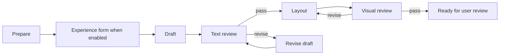

# Headless editorial workflows

LangGraph owns stage transitions and durable checkpoints. Work can be performed by the **current Codex session**, or by explicitly starting one **Codex TypeScript SDK** job. Both use the same task/result validation. Saved Codex login works without an API key. Electron and shell orchestration loops are not required.

## Start

Use Node 22.12+ and the repository dependencies (`npm ci`).

```sh
npm run build:web
npm run start:server
```

The desktop app starts this server itself (see [Desktop embedded server](#desktop-embedded-server--2026-11-03)); run `npm run start:server` only for browser/CLI/MCP use without the app.

Open `http://127.0.0.1:4318/?workflow=1`. The existing Dashboard shell includes a Workflow tab. Workflow create/list/task/result/restart operations work without Electron. Other existing native features (Photos, native editor and hidden Electron reference extraction) retain their current platform requirements; this change does not pretend to port those tools to a browser.

`REELS_WORKFLOW_DATA` selects the private storage directory (default `~/.local/share/reels-dashboard/workflows`). SQLite checkpoints and run IDs live outside the source repository. `REELS_WORKFLOW_PORT` sets the server port; clients use `REELS_WORKFLOW_URL`. One server owns a storage directory. CLI and MCP always call that server, rather than independently executing the same graph. The HTTP service binds only to `127.0.0.1` and rejects other Host/Origin values.

## Work from this Codex session

The session can control the workflow immediately through the CLI; it does not need a new model API or a child Codex process.

```sh
npm run workflow -- create /absolute/path/to/run-input.json
npm run workflow -- list
npm run workflow -- get <run-id>
npm run workflow -- submit /absolute/path/to/result.json
npm run workflow -- restart <run-id>
```

`create` and `submit` also accept `-` for a JSON stdin stream. Keep input/result files in the content workspace or a private temporary directory, not in this public repository.

Create payload:

```json
{
  "title": "A blog draft",
  "workspace": "/absolute/path/to/content",
  "instructions": "Read the workspace writing criteria and source notes; preserve confirmed experience. Record unresolved questions.",
  "trackedFiles": ["source-notes.md"],
  "maxRevisions": 2
}
```

The tracked files must exist. Workspace instructions and editorial policy are supplied by the content workspace, not copied into the app. Each task returns its ID, stage, instruction, input hashes, workspace and history. Read these before doing the work. Use normal session file/image/browser tools to execute the task. The graph does not itself decide whether a review is correct. An SDK job receives the task, workspace instructions, input paths and previous reports; it runs in a separate Codex thread.

Result payload:

```json
{
  "runId": "UUID returned by create",
  "taskId": "exact pending task ID returned by get",
  "outcome": "done",
  "summary": "Prepared the source facts; missing information is listed in the report.",
  "evidence": ["facts.md", "preparation-review.md"]
}
```

Paths are relative to the workspace; missing files, directories, traversal and symlinks escaping it are rejected. `done` requires evidence and is used for preparation, draft, revision and layout. Those result files are automatically added to tracked inputs for subsequent tasks. `pass`/`revise` are only accepted for text and visual review. A review must inspect frozen inputs and write its report to a separate file. Existing tracked source/draft/render files cannot be edited while submitting a review; update inputs first, call `restart`, then review the new task. `blocked`/`cancel` can stop any task with a reason and do not require evidence.

## Graph and control semantics

Photo-based full drafting uses the existing stages: `prepare` inventories scenes, `draft` first composes images and then prose, and `layout` carries the decisions forward. A tracked `media-scenes.json` enables structural draft-plan validation without changing the state graph or requiring an experience form. See [photo-first drafting](photo-first-drafting.md) for artifacts, paths, unchanged legacy behavior and validator limits.



Every stage is a durable external-work interrupt. Leaving it waiting is a pause; no session needs to remain alive. Returning `blocked` records an unresolved result. `restart` invalidates a pending request or reopens a held run; a ready run reopens at text review. It never resets revision counts and cancelled runs cannot reopen. The revision budget is total across text and visual loops. A request beyond that budget ends blocked. Prior reports remain historical evidence, not current approval.

The engine validates task IDs, outcome/stage compatibility, evidence existence and file hashes. It does not grade prose or verify that a screenshot was actually inspected. The current session must follow the workspace review procedures. The graph cannot save to SmartEditor or publish; local `ready` is not publication approval or publication success.

If layout work changes previously approved source/prose files, the graph returns to text review. Layout-only outputs are tracked for visual review without turning every render update into a new text review.

## MCP

Run `npm run start:workflow-mcp` as an independent stdio server while the HTTP server is running. It does not require the Electron MCP socket. It provides:

- `reels_workflow_list`
- `reels_workflow_get`
- `reels_workflow_create`
- `reels_workflow_submit`
- `reels_workflow_restart`
- `reels_workflow_capabilities`
- `reels_workflow_execute`
- `reels_workflow_job`
- `reels_workflow_stop`

Example MCP client configuration (adapt the path and Node executable to the local machine):

```toml
[mcp_servers.reels_workflows]
command = "node"
args = ["--import", "tsx", "/absolute/path/to/reels-dashboard/src/app/workflow/mcp.ts"]
cwd = "/absolute/path/to/reels-dashboard"

[mcp_servers.reels_workflows.env]
REELS_WORKFLOW_URL = "http://127.0.0.1:4318"
```

Clients may require reconnection to discover a new MCP server. An already-open session can use the CLI without changing its MCP configuration. No global client configuration is modified by this feature.

## Ownership and verification

`src/app/workflow/runtime.ts` is the only graph/runtime implementation. HTTP, CLI, MCP and the browser share it through the local server. Existing historical blog shell runners are not invoked. This is the new headless path; old content artifacts and archived runners remain intact.

Checks: `npm run typecheck`, `npm run check:architecture`, `npm run test:workflow`, `npm run build:web`, `npm run test:workflow-ui`. Runtime tests exercise persistent interrupts, stale review rejection, duplicate results, revision routing/limits, cancellation, server ownership and actual stdio MCP + CLI interoperability. UI tests use a real headless server and browser with synthetic files. They do not claim real editorial quality or SmartEditor integration.

Verified on 2026-11-01: 101 unit tests passed; the 3 workflow tests were rerun after the final text-approval invalidation change. The headless workflow browser test and 10 existing shared-web/shell tests passed. Typecheck, architecture check, original-spec preservation, web build, desktop bundle build and diff whitespace check passed. Desktop/mobile screenshots were inspected in `test-results/workflow/`. No packaged app installation, real article generation, SmartEditor transfer or publication was performed.


## Codex SDK execution — 2026-11-01

`@openai/codex-sdk` is a backend dependency. The default executable is the local `codex` CLI; `REELS_CODEX_BIN` can select another installed executable. No API key was created, saved or copied. A configured server environment key is selected in this order: `REELS_WORKFLOW_API_KEY`, `CODEX_API_KEY`, `OPENAI_API_KEY`. With no key, the executor uses the existing ChatGPT/Codex login immediately. With a key, it tries API authentication first and falls back once to saved login only for a recognized authentication/quota/rate-limit error **before tool work or an agent response has started**. Network errors, permission errors, malformed output, editorial rejection and cancellation do not switch authentication.

The login attempt has an explicit environment allowlist without API keys or parent session IDs and forces ChatGPT authentication for that invocation. API credentials are backend-only; shell children exclude key variables. This does not rewrite the user's Codex settings or auth files. A missing/expired login is reported as a job failure, not fixed by creating a key.

Local-channel lifecycle fix (2026-11-01): SDK subprocesses explicitly set
`CODEX_LOCAL_CHANNEL_DISABLED=1`. The local-channel SessionStart hook honors
this marker instead of launching or rebinding a detached App Server for each
automated job. Environment filtering alone did not opt out of that hook.
Other user hooks and authentication settings remain intact. This is separate
from the image analyzer's invocation-local MCP isolation; both execution paths
now carry the opt-out. The accumulated six-day local bridge predates this SDK
integration; it was not a child of the Dashboard mobile briefing bridge.

```sh
npm run workflow -- capabilities
npm run workflow -- execute /private/path/task.json
npm run workflow -- job <job-id>
npm run workflow -- stop <job-id>
```

Execute payload: `{"runId":"run UUID","taskId":"exact pending task ID"}`. Each execution handles **one step**; the next step waits for another explicit action. Starting SDK execution claims the pending task, blocking simultaneous manual submission, restart or another SDK execution. Cancellation releases the task without treating it as complete. Jobs, authentication attempts, bounded progress events, thread IDs and usage persist in SQLite. On server restart, unfinished jobs are marked interrupted and are not automatically run again.

SDK workflow jobs use read-only tools and structured output. The host saves new candidate/report files under `.workflow-results/<job-id>/` inside the content workspace, verifies input hashes and submits the result. It does not overwrite the canonical manuscript. Rendering requiring writable browser tools can still be performed in the current interactive session; the SDK must return blocked when it cannot actually inspect the required visual evidence. No publication or outbound messaging tool is supplied. A five-minute timeout and explicit stop abort the SDK turn.

### Dashboard and blog UIs

- Dashboard Workflow tab: **Codex로 현재 단계 실행**, execution status/history, authentication used and stop. Manual result submission remains available when no SDK job is running.
- Standalone canonical blog editor (`?blogEditor=1`): **Codex로 선택 묶음 검토** uses the same workflow server through a same-origin proxy. Save edits before requesting review; later revision or unsaved changes lock result application. Applying a suggestion changes the editable view; the existing **정본 저장** action commits it. Run the workflow server alongside the blog editor. `REELS_WORKFLOW_URL` on the editor server selects its backend.
- Electron: a bounded preload/main-process bridge calls the same server. No SDK or credentials enter the renderer. The source build includes this bridge; replacing an already installed packaged application is a separate action.

Bundle SDK review is **text-only**, including supplied alt/context. It does not send local photos or claim rendered visual review. The `review-bundles` CLI/HTTP action accepts `{request, criteria?}` and returns a job; completed `job.result` follows the existing `blog.bundle-review.result` contract. Canonical editor converts saved paragraphs into this common contract instead of maintaining another SDK implementation.

Live validation: one synthetic prepare task ran with saved Codex login, generated its candidate and advanced to draft. No API key was used. Future API-key priority/fallback, cancellation, concurrency, malformed results, stale input and interrupted-job recovery are covered by injected SDK tests; real API-key execution remains unverified.

Final SDK checks: current unit suite 120/120 passed; Dashboard SDK/manual browser flows 2/2, standalone canonical SDK browser flow 1/1 and Electron-to-headless bridge 1/1 passed. Typecheck, architecture, preserved-spec and web/desktop builds passed. Both running local servers (4318 and canonical editor 4320) returned `apiKeyConfigured: false`, `priority: ["codex-login"]` from capabilities. No installed app package was replaced.


## Model, usage and cost observations

[AI observability](ai-observability.md) documents the provider-neutral record, Codex native metadata adapter, standard OpenTelemetry export and optional Langfuse mapping. Each authentication attempt retains its own model provenance, role, instruction hash, tokens, time and cost status. The shared SDK progress UI displays these records in Dashboard and the blog editor. The default is local-only, with no API-key creation or hosted telemetry setup. API estimates require a current price catalog; absent data is not reported as zero.

## 사진 기반 경험 수집

새 작업의 경험 폼 옵션, 질문 계약, 답변 일괄 저장과 초안 연결은 [경험 수집 단계](experience-intake.md)를 따른다. API 생성 시 `collectExperience: true`로 켜고 준비 결과에 `experience-form.json`을 포함한다. 사용자 답변 없이 이 단계를 SDK로 통과할 수 없다.

## Isolated publication verification — 2026-11-01

The workflow/SDK/observability snapshot passed 95 unit tests, 2 headless workflow browser tests and 1 Electron-to-server bridge test in a separate checkout. Typecheck, web/desktop build, architecture and preserved-spec checks passed. Installed dependencies were copied from the local dependency cache; no fresh dependency-download claim is made. Separate canonical-blog editor, reference extraction and media-analysis changes are outside this snapshot.

## Inline suggestions (`suggest-inline`) — 2026-11-03

`suggest-inline` is a **synchronous, transient** workflow action used by the markup blog editor's manual **✦ 추천 받기** ([Tab suggestions](markup-editor-integration.md#tab-suggestions--2026-11-03)). It is part of the `workflowAction` enum and is served at `POST /api/workflows/suggest-inline`. The blog editor server calls it with `workflowRequest`; it is not a `npm run workflow` CLI subcommand.

- Input (`inlineSuggestInput`, `src/shared/inline-suggest.ts`): `{id: uuid, paragraphId, title ≤300, before ≤4000, after ≤4000, context ≤60000, rules ≤20000, guidance ≤60000}`. `before`/`after` are the plain paragraph text around the caret. `context` is the neighbouring bundles' markup with the unsaved paragraph substituted.
- Execution: `CodexExecutor.suggestInline(input, signal?)` runs one SDK turn through the same `SdkFactory`, `codexEnvironment` allowlist and API-key → saved-login fallback as other jobs. The thread is read-only, `approvalPolicy: never`, with no network and no web search. `outputSchema` is the `inlineSuggestResult` JSON schema (`{suggestions: ≤3 × {text 1..240}}`). The prompt (`buildSuggestPrompt`) asks for at most one sentence in the writer's Korean voice, plain text without markup, with no repeat or contradiction of the text after the caret, following the rules and guidance. It treats the manuscript and annotations as data and asks for an empty list when the model is not confident.
- Settings: `REELS_SUGGEST_MODEL` (falls back to `REELS_CODEX_MODEL`), `REELS_SUGGEST_REASONING_EFFORT` (default `low`) and `REELS_SUGGEST_TIMEOUT_MS` (default 90000; values outside 1000–600000 use the default). The timeout and the HTTP client disconnecting both abort the SDK turn. A small concurrency cap refuses excess parallel suggestions.
- Output: `{id, suggestions: string[], elapsedMs, authModes}` after `cleanSuggestions`.
- **No persistence**: no SQLite job, no artifacts and no workspace files. A suggestion cannot be listed, polled, resumed or stopped through `job`/`stop`. Nothing is written to the manuscript; the editor inserts text only when the writer accepts it. As with every Codex SDK job, the Codex CLI itself still writes its own session rollout under the user's Codex home and loads the user's Codex configuration.
- A workflow server started before this action existed answers `Unknown workflow action`; restart it. Clients now show the [stale-server message](#desktop-embedded-server--2026-11-03) instead of that raw text.

Verification (2026-11-03): `tests/unit/workflow-suggest.test.ts` (7) passed within `npm test` 220/220 on Homebrew Node 26. A live probe ran on a separate port (never 4318) with the real SDK, saved Codex login (`authModes: ["codex-login"]`), the default model and effort `low`, using synthetic Korean text. Calls that returned took 5.3–12.2 s. Examples: `일요일 아침에 동네 공원을 ` → `걸었어요.`; `돌아오는 길에 빵집에 들러 ` before `집에 와서…` → `빵을 사서 `. End-of-paragraph positions usually returned an empty list, because the prompt forbids inventing new facts. Many calls in the same window produced no SDK event after `turn.started` and ended at the 90 s timeout. A plain `codex exec` with the same default model also stalled for 90 s at that time, so the stalls were attributed to backend or account latency, not to this action.

## Selection chat (`chat-blog`) — 2026-11-04

`chat-blog` is the second **synchronous, transient** action, used by the markup blog editor's [구절 채팅](canonical-blog-editor.md#구절-채팅--2026-11-04). It is served at `POST /api/workflows/chat-blog` and called by the editor server through `workflowRequest`.

- Input (`blogChatInput`, `src/shared/blog-chat.ts`): `{id: uuid, title ≤300, question 1..2000, history ≤12 × {role, text ≤4000}, attachments ≤5 × {paragraphId, quote ≤2000, paragraph ≤20000}, context ≤60000, rules ≤20000, guidance ≤60000}`. `paragraph` is the plain text the writer currently sees (unsaved edits included); `context` is the bundles around the attached paragraphs (or the selected bundle) with unsaved attached paragraphs substituted.
- Execution: `CodexExecutor.chatBlog(input, signal?)` — same read-only, no-network SDK turn and auth fallback as `suggestInline`, sharing its concurrency cap. `outputSchema` is `blogChatResult` (`{reply ≤4000, rewrites ≤3 × {paragraphId, quote, replacement}}`). The prompt (`buildChatPrompt`) treats manuscript, annotations and history as data and only QUESTION as the request; rewrites must quote the attached paragraph exactly and use only facts in the manuscript.
- Settings: `REELS_CHAT_MODEL` (falls back to `REELS_CODEX_MODEL`), `REELS_CHAT_REASONING_EFFORT` (default `medium`), `REELS_CHAT_TIMEOUT_MS` (default 120000).
- Output: `{id, reply, rewrites, elapsedMs, authModes}` after `cleanChatResult`, which drops rewrites whose paragraph is not attached or whose quote is missing or ambiguous in that paragraph, and strips markup from replacements.
- **No persistence**, as with `suggest-inline`. `WORKFLOW_PROTOCOL_VERSION` is now 3, so a server started before this action is reported as stale and must be restarted.

## Desktop embedded server — 2026-11-03

The desktop app now runs the workflow server inside its Electron main process (`src/desktop/workflow-host.ts`). You no longer need to start `npm run start:server` next to the app. Because the server is part of the app build, it cannot run older code than the app.

**Modes** (decided once at launch, in this order):

| Condition | State | Behaviour |
|---|---|---|
| `REELS_WORKFLOW_URL` is set | `external` | Uses that URL and never starts a server. Electron tests that run their own server use this mode. |
| Nothing listens on the workflow port | `embedded` | Calls `startWorkflowServer({root, port, webRoot: <app>/dist, embedded: true})` in-process. |
| A compatible server listens and uses the same data directory | `shared` | Reuses it, for example the installed app or a current standalone server. |
| A workflow server with another protocol version (or without one) listens | `stale` | Does not start or replace it. Shows the older or newer message below. |
| A compatible server uses another data directory, the start fails, the port is used by something else, or the server does not respond | `error` | Shows a readable message (the data-dir case names both directories). The rest of the app keeps working. |

- Settings: port `REELS_WORKFLOW_PORT` (default 4318; `0` picks a free port and skips the probe), data `REELS_WORKFLOW_DATA` (default `~/.local/share/reels-dashboard/workflows`). These are the same names and defaults as the standalone server.
- The probe sends `GET /api/workflows/capabilities` with a 1.5 s timeout. Capabilities now include `server: {protocol, actions, root, pid, embedded}`. A server is compatible only when `server.protocol` equals `WORKFLOW_PROTOCOL_VERSION` (`src/shared/workflow.ts`, currently `1`), `server.actions` contains every `workflowAction` this build can send, and it reports `server.root`. Any other workflow server (including one without `server.actions` or `server.protocol`, which predates this change) counts as stale.
- Protocol version: bump `WORKFLOW_PROTOCOL_VERSION` whenever a handler's request/response semantics change, even if no action is added. A long-running standalone server with older handler code but the same action names is then reported as stale instead of being reused. There is deliberately no per-build fingerprint: a dev build and the installed app of the same protocol share the same default data directory by design and must not flag each other.
- Data directory: `server.root` is the server's `realpath` of its data dir. The app shares a compatible server only when that equals the `realpath` of its own `REELS_WORKFLOW_DATA` (a dir that does not exist yet resolves through its nearest existing parent). Otherwise the state is `error` with `포트 <port>의 워크플로 서버는 다른 데이터 폴더(<server dir>)를 사용 중이에요. 이 앱의 데이터 폴더는 <app dir>이에요. …`, so the app never reads or changes another data dir and never switches dirs after a takeover.
- Stale message (Workflow panel notice, and the error for any `Unknown workflow action` reply, including canonical-editor review/suggestions): `실행 중인 워크플로 서버가 이전 버전이에요. 따로 실행한 서버(npm run start:server)를 종료한 뒤 앱을 다시 시작해주세요.` When the server's protocol is higher than the app's: `실행 중인 워크플로 서버가 이 앱보다 새 버전이에요. 앱을 업데이트하거나 그 서버(다른 앱 또는 npm run start:server)를 종료한 뒤 앱을 다시 시작해주세요.`
- URL: before anything makes a request, the host writes the resolved URL to `process.env.REELS_WORKFLOW_URL` in the main process. `workflowRequest`, the in-process canonical editor's `/api/workflows` proxy and input-form windows read it on every request. `workflow:hostStatus` (preload `reels.workflow.hostStatus()`) returns `{state, url, message?}`.
- Takeover: in `shared` mode, if a main-process workflow request (the renderer bridge, notification polling or MCP forms) gets `ECONNREFUSED` because the other owner quit, the app starts its own server on the same port and retries once. It tries at most once every 5 s. The canonical editor uses the same URL, so it recovers after that takeover. If the port is now held by a server with another protocol or data dir, the state changes to that `stale`/`error` instead.
- Startup race: when two instances probe an empty port at the same time, the loser gets the data-dir owner lock error or `EADDRINUSE`. On a fixed port (not `0`) it re-probes for about 2 s (200/300/500/500/500 ms) and becomes `shared` once the winner answers compatibly with the same data dir, so it can still take over after the winner quits. If nothing answers in that window it shows the readable error; restart the app. A takeover that loses the same race shares the new winner and retries the request there.
- Quit: the server closes after the canonical editors. If SDK jobs or inline suggestions are still running, a 취소/종료 dialog warns first: on app quit, and also when the dashboard window is closed (closing it quits the app, so 종료 quits and 취소 keeps the window). Dialogs use the dashboard window as parent only while it still exists; otherwise they open unparented. Every `before-quit` that arrives while cleanup runs (for example `window-all-closed` after the last canonical-editor window is destroyed) is held, and only the final quit issued after `workflowHost.dispose()`, the agent socket and the native client have finished may exit (`src/desktop/shutdown.ts`). Interrupted jobs are marked `interrupted` on the next start, as before.
- Codex from Finder/Dock: when `REELS_CODEX_BIN` is unset, the embedded server's SDK environment adds `/opt/homebrew/bin`, `/usr/local/bin`, `~/.local/bin`, `~/.npm-global/bin`, `~/.volta/bin` and `~/.bun/bin` to the front of `PATH`, if those directories exist. Node's `spawn` looks up `codex` using the child's `env.PATH`. Env values are never logged.
- Checkpoints: `SqliteSaver` now runs on `node:sqlite` (`src/app/workflow/sqlite-checkpointer.ts`) for both the standalone and embedded servers. better-sqlite3 is a native addon built for one Node ABI and cannot load in Electron. The `checkpoints.sqlite` file format is unchanged.
- Bundle: `scripts/build-desktop.mjs` maps `import.meta.url` to the bundle file for the CJS main bundle. Without this, `@openai/codex-sdk` would call `createRequire(undefined)` at load.

**Dev build and installed app together:** whichever app or server binds 4318 first owns the default data directory. Others reuse it while it has the same protocol version, actions and data directory. When the owner quits, the next one to make a workflow request takes over. A dev build with a higher protocol version sees an older installed app as `stale` (older message), and the installed app sees the dev build as `stale` (newer message). Close one of them, or give the dev build its own `REELS_WORKFLOW_PORT` and `REELS_WORKFLOW_DATA`.

**Standalone path unchanged:** `npm run start:server`, `npm run workflow`, `npm run forms` and the MCP server work as before. If you run a standalone server while using the app, stop it after you update the code. The app reports it as stale when the protocol version or action list changed; a code change that bumps neither is not detectable, which is why handler semantic changes must bump `WORKFLOW_PROTOCOL_VERSION`.

**Test isolation:** `tests/electron/helpers.ts` never passes a parent shell's `REELS_WORKFLOW_URL/PORT/DATA` to the app. When a test does not pass a URL, it sets `REELS_WORKFLOW_PORT=0` and `REELS_WORKFLOW_DATA=<profile>/workflow-data`, so QA never binds 4318 or opens real workflow data.

Verification (2026-11-03): `tests/unit/workflow-host.test.ts` covers mode decisions, takeover and its rate limit, real probe classification, protocol-version mismatch (older and newer, same action set), data-dir mismatch against a real server on a temp dir (and sharing through a symlinked path), startup-race re-probe and later takeover, a takeover that loses the race, capabilities `server` fields, stale-message mapping and the GUI PATH lookup through `codexEnvironment`. `tests/unit/desktop-shutdown.test.ts` covers holding a nested quit during cleanup, one-shot cleanup with a final quit after failure, and the live-window dialog parent. `tests/electron/workflow-embedded.spec.ts` covers the embedded server through the renderer bridge, port and data-lock release on quit, and the stale notice against a fake old server on a free port.
